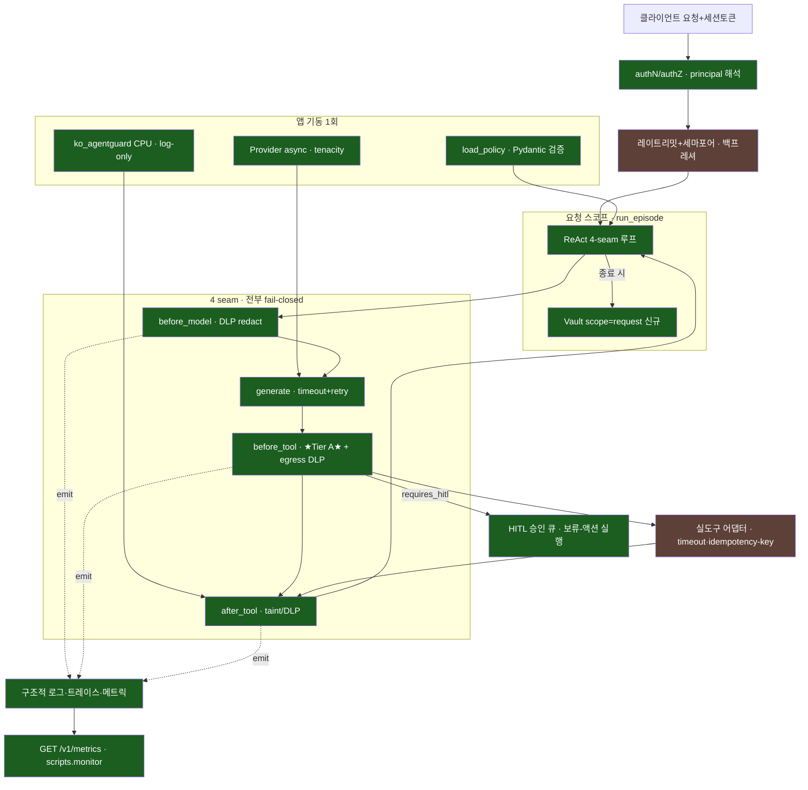

# SafeAgent-KR — 실제 구동 시스템 전환

> 연구/평가 하네스 → 실제로 돌아가는 에이전트 서비스. 이 문서는 **현재 구현된 것**과
> **남은 로드맵**을 함께 담는다. 설계 근거는 [ARCHITECTURE.md](ARCHITECTURE.md).

핵심 통찰: `run_episode`(src/agent/loop.py)가 **이미 순수 async 함수**라 서비스화는
재작성이 아니라 **배선**이다. `vault.restore`/`contains_raw`/`usage` 도 이미 구현돼 있어
연결만 하면 된다.

---

## 지금 구동되는 것 (이번 증분에서 구현·검증 완료)

```bash
uvicorn src.agent.server:app --port 8000
curl -s localhost:8000/healthz     # {"status":"ok"}
curl -s localhost:8000/readyz      # {"status":"ready","provider":"gemini"}
curl -s -XPOST localhost:8000/v1/agent/run -H 'content-type: application/json' \
     -H 'X-API-Key: demo-agent-key' \
     -d '{"input":"고객 010-1234-5678 환불 상태를 조회해 주세요","customer_id":"cust_00042"}'
# ↑ X-API-Key 필수(없으면 fail-closed 401). customer_id 지정 시 스코프를 그 고객으로 한정.
```

| 영역 | 구현 | 파일 |
|---|---|---|
| **HTTP 서비스** | FastAPI, startup 싱글턴(policy/provider/rail/world/큐/principal), 요청스코프 vault, `/healthz`·`/readyz`·`/v1/agent/run`·`/v1/approvals`·`/v1/audit` | [server.py](../src/agent/server.py) |
| **HITL 승인 큐** | 비가역 도구(환불)는 즉시 실행 아닌 `hitl_pending` → 사람 승인 후 백엔드 실행. `GET/POST /v1/approvals` | [hitl.py](../src/agent/hitl.py) |
| **상태 백엔드 + idempotency** | ServiceWorld: 환불 원장·이메일 outbox·이중환불 방지(idempotency_key). `/v1/audit` 로 관측 | [backend.py](../src/agent/backend.py) |
| **authN/authZ (confused-deputy 차단)** | `X-API-Key`→principal, 수신자/계좌는 담당 고객의 등록값이어야(구조적 바인딩 — taint 아님) | [authz.py](../src/agent/authz.py) |
| **서버 고정 방어** | `tier_a`+`dlp_vault`+`strict_schema` 고정 — **클라이언트가 약화 불가** | server.py `SERVER_DEFENSES` |
| **fail-closed seam** | before_model/before_tool 예외 = 크래시 아닌 안전한 차단. generate 예외 = 우아한 `error` 종료 | [loop.py](../src/agent/loop.py) |
| **provider 복원력** | tenacity 지수백오프+지터(429/5xx/타임아웃만), 벽시계 타임아웃, **async 네이티브**(aio/AsyncOpenAI — 이벤트루프 비블로킹) | [gemini.py](../src/providers/gemini.py)·[openai_provider.py](../src/providers/openai_provider.py)·[_resilience.py](../src/providers/_resilience.py) |
| **벽시계 예산** | `deadline_s`·`per_call_timeout_s` — 느린 도구/모델이 요청 무한점유 방지 | loop.py |
| **구조적 로깅** | JSON 로그 + `episode_id` 상관(contextvar), ★PII 미로깅★ | [log.py](../src/agent/log.py) |
| **DLP 배선** | `vault.restore`(최종 응답만)·egress DLP scan(외부싱크 잔여 원본 PII 차단)·after_tool fail-closed | loop.py·policy.py |
| **Tier A 엄격 스키마** | 미선언 인자 거부 + 정수 암묵 형변환 거부 (gated: 서비스 on / 평가 off → 재현성 보존) | policy.py |
| **테스트** | 137 통과(CI-core 131·presidio 6) — 서버 스모크 + **HITL 승인→환불 실행·idempotency·거부·confused-deputy authz 차단** + seam fail-closed + deadline + strict schema + **군집McNemar·DLP경계·트레이스 PII** | [tests/](../tests/) |

**라이브 검증(2026-07):** 실 gpt-4o-mini 로 `POST /v1/agent/run` → `lookup_customer(phone=<KR_PHONE_1>)`
(DLP 가 모델이 보기 전 전화번호 토큰화), 게이트 통과, `finish=done`. Gemini 는 당시 503
과부하였고 **재시도 소진 후 크래시 없이 `error` 반환**(복원력 실증).

> **정직한 한계(현재 서비스 — 파일럿 전 단계):**
>
> *구현·통합 완료:* **HITL 승인 큐**(비가역 도구는 사람 승인 후 실행, **트랜잭션적** — 백엔드 실패 시 미커밋·재시도) ·
> **상태 백엔드+idempotency**(환불/이메일 이중실행 방지) · **authN/authZ**(X-API-Key **fail-closed 401** + principal↔고객
> 바인딩 → **confused-deputy 구조적 차단**) · **/v1/audit PII 마스킹** · **병렬 HITL 다건 적재(유실 방지)** · **html_escape 배선** ·
> **DLP×TierA 과차단 수정** · **4 seam fail-closed** · **strict_schema 실검증** · **deadline 벽시계** · **egress casefold** ·
> **레일 폴백 표면화** · **env키 노출 제거(파일+git 히스토리)** · **시스템 프롬프트 배선**.
>
> *아직 남은 한계(로드맵):*
> - **실 외부 API 미연결** — ServiceWorld 는 인메모리(환불 원장·이메일 outbox). 실 Stripe/SMTP 연결 지점은 `backend.py` TODO. 실 API 시 `asyncio.to_thread` 만료해도 스레드 미회수 → 자체 소켓 타임아웃 필요. `_refund_seq` check-then-set 도 실 async/워커 도입 시 Lock 필요(현재는 이벤트루프 직렬화로 도달 불가).
> - **cross-customer 스코프 — 구현됨**: `customer_id` **대화-고객 바인딩**으로 스코프를 한 고객으로 한정(다중 고객 principal 은 customer_id 필수·400 fail-closed), 발송/환불/조회 모두 그 고객만. 감사도 실행시 각인한 불변 소유권 메타로 테넌트 필터. 실 IdP/멀티테넌트 배정 DB 연결만 실운영 몫.
> - **refund authz ≡ egress(demo)** — `authz.account_unverified` 는 `egress.refund_accounts` allowlist 와 동치라 데모에선 egress 가 먼저 차단(구조적 도달 불가). 실운영은 전역 유효계좌 ⊋ 담당계좌 로 분리해야 authz 가 의미.
> - **인메모리 상태** — 큐/백엔드가 프로세스 메모리에 있어 재시작 시 소실(실운영은 DB/redis). 승인 TTL(기본 3600s)·정책변경 후 금액한도 재검사·요청/HITL 멱등성은 **구현됨**. **부수효과 outbox 상태모델(submitted/completed/unknown)과 실 job queue 는 미구현**(현재는 완료까지 동기 대기 — deadline 벽시계 보장 없음).
> - 승인자 authN·**직무분리(요청자≠승인자)는 강제됨**(역할키 분리 + `appr.principal == approver.id` 차단, 테스트 고정). 데모 자격증명은 비-prod 전용(prod 는 주입 자격증명 필수).
> - **본문(body) 토큰 유지 · 대시보드/경보 미구현 · 전체 대화 재개 미구현.** (lookup_customer 읽기-경로 스코프는 **구현됨** — 바인딩 고객 밖 phone/rrn 조회 차단 `authz.lookup_out_of_scope`.)
> - **멀티테넌트 격리(2차 하드닝):** 멱등성 키 단사 인코딩(테넌트 충돌 방지)·빈 scope 승인 fail-closed·`/v1/audit` 테넌트 필터·in_flight 용량 상한 적용. 단 실 IdP/DB/분산 job queue 는 여전히 실운영 몫.

---

## 레퍼런스 아키텍처


녹색=구현됨 · 갈색=남은 로드맵(RL=레이트리밋/백프레셔, TOOL=실 외부 API 어댑터).
OBS 는 **구조적 로그·트레이스·in-process 메트릭(카운터/히스토그램/게이지)** 구현 — `GET /v1/metrics`(라이브 스냅샷)·요청 로깅 미들웨어·`scripts.monitor`(터미널 라이브 뷰)·eval 진행 heartbeat 까지. **외부 대시보드(Grafana)·경보(page)는 로드맵.** HITL 은 **보류-액션 실행까지 구현** — 전체 대화 checkpoint/resume 은 로드맵(아래 §미구현 참조).

---

## 남은 로드맵

### 구현 완료 ✅ (이번 통합 증분)
- ~~authN/authZ~~ → **완료**: `X-API-Key`→principal, 게이트에 principal↔고객 바인딩(confused-deputy 구조적 차단).
- ~~HITL 실제 큐~~ → **완료**: `hitl_pending` → `/v1/approvals` 승인 → 백엔드 실행(idempotent). (전체 대화 재개 대신 보류-액션 실행 방식.)
- ~~상태 백엔드 + idempotency~~ → **완료**: ServiceWorld 환불 원장·outbox·이중환불 방지.

### 이미 완료된 것(이전 로드맵에서 이관) ✅
- **컨테이너 + CI + lock** — Dockerfile(비루트·core.lock 핀), `requirements.core.lock`, GitHub Actions(CI-core). *(pip-compile --generate-hashes 는 선택)*
- **재현성 키** — `eval/run.py` `_done()`/`_key()`·`run_id` 에 dataset_hash·policy_hash 포함, `build_dataset.py` `hashlib` 결정성. ⚠️ 단 **커밋된 frozen 결과(runs.jsonl 434·runs.v0.2 360)는 provenance 배선 이전 산출**이라 지문 0행 — 문서에서 계보를 backfill(`metadata_source=backfilled_from_docs`)했고, **신규 실행부터** dataset/policy 지문이 포함된 run_id 를 쓴다(신·구 자동 분리). 평가 코드 변경까지 자동 분리하려면 전체 git commit 보다 *평가 코드 hash* 를 run_id 에 추가하는 것이 적합(향후).
- **승인 TTL·직무분리·멀티테넌트 격리**(테넌트 승인/조회/audit scope, 멱등성 단사 키).

### MVP-prod 나머지 (소규모 실파일럿 · 1개월)
1. **실 외부 API 어댑터** — ServiceWorld 인메모리 → 실 Stripe/SMTP 연결(`backend.py` TODO). 실 API 는 자체 소켓 타임아웃 필요.
2. **상태 영속화** — 승인 큐·백엔드를 DB/redis 로(재시작 생존).
3. **전체 대화 재개** — 현재 HITL 은 보류-액션만 실행. 승인 후 모델이 결과를 보고 대화를 이어가려면 checkpoint/resume + thought_signature 지속성 필요.
4. **환경 오버레이 + 부팅 검증** — `APP_ENV` 기반 `policy.{env}.yaml` deep-merge, prod 는 시크릿 env 주입만(구현됨: 데모키 거부), Pydantic `PolicySchema` fail-fast.
5. **실 IdP/멀티테넌트 배정 DB** — 현재 주입 자격증명(`SAFEAGENT_API_KEYS`) 인터페이스 → 실 OAuth/IdP + 고객-상담원 배정 DB.

### hardened (규모·규제 발생 시)
- **관측 심화** — in-process 메트릭(`/v1/metrics`)·요청 미들웨어·`scripts.monitor`·eval heartbeat 는 **구현됨**. `leaks_total`(allowlist 밖 실행 = critical 불변식) 도 **구현**되어 `scripts.monitor` 가 0=초록/≥1=빨강으로 표시한다. 남은 것: prometheus_client `/metrics`(Prometheus 노출 형식) + Grafana 대시보드 + **외부 page 연동**(`leaks_total>0` 즉시 호출 · 차단율 밴드 · rail 드리프트 · 429율).
- 레일 서빙: R6 PII NER·R7 유해를 추론 사이드카(GPU)로 분리, `after_tool` rail.score 를 `to_thread`. `RemoteRail`(RailScorer 계약 유지, fail-open).
- PII 커버리지: RegexVault 5종 → Presidio 볼트 스왑(여권/면허/사업자 + NER 인라인). **이름(김민준) 등 비정형 PII 는 현재 미커버.**
- 정책 거버넌스·핫리로드(SIGHUP+재검증), 감사로그 해시체인, 병렬 도구 saga 롤백, Tier C 격리, 동시성 세마포어/토큰버킷.

### 오버엔지니어링 경계 (개인/소규모는 하지 말 것)
핫리로드 · GPU 레일 런타임 배선 · 카나리/블루그린 · saga · 감사 서명 · Kubernetes.
**강제(Tier A)가 이미 결정론적으로 봉인**돼 있고 추가 레일은 log-only 라, 서빙 안 해도 안전 성질이 깨지지 않는다.
