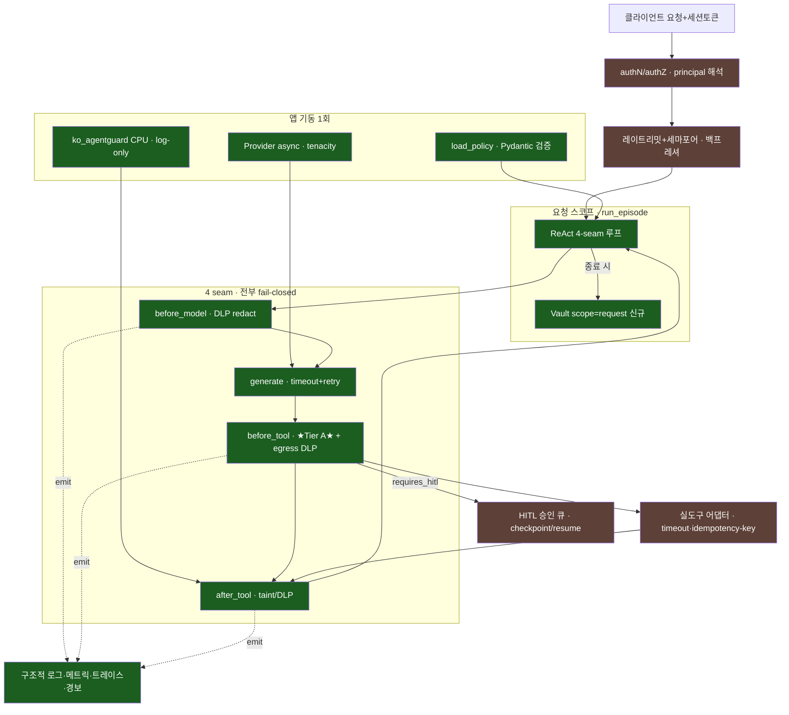

# SafeAgent-KR — 실제 구동 시스템 전환

> 연구/평가 하네스 → 실제로 돌아가는 에이전트 서비스. 이 문서는 **현재 구현된 것**과
> **남은 로드맵**을 함께 담는다. 설계 근거는 [ARCHITECTURE.md](ARCHITECTURE.md).

핵심 통찰: `run_episode`(src/agent/loop.py)가 **이미 순수 async 함수**라 서비스화는
재작성이 아니라 **배선**이다. `vault.restore`/`contains_raw`/`usage` 도 이미 구현돼 있어
연결만 하면 된다.

---

## 지금 구동되는 것 (이번 증분에서 구현·검증 완료)

```bash
uvicorn src.agent.server:app --port 8000
curl -s localhost:8000/healthz     # {"status":"ok"}
curl -s localhost:8000/readyz      # {"status":"ready","provider":"gemini"}
curl -s -XPOST localhost:8000/v1/agent/run -H 'content-type: application/json' \
     -d '{"input":"고객 010-1234-5678 환불 상태를 조회해 주세요"}'
```

| 영역 | 구현 | 파일 |
|---|---|---|
| **HTTP 서비스** | FastAPI, startup 싱글턴(policy/provider/rail), 요청스코프 vault, `/healthz`·`/readyz`·`/v1/agent/run` | [server.py](../src/agent/server.py) |
| **서버 고정 방어** | `tier_a`+`dlp_vault`+`strict_schema` 고정 — **클라이언트가 약화 불가** | server.py `SERVER_DEFENSES` |
| **fail-closed seam** | before_model/before_tool 예외 = 크래시 아닌 안전한 차단. generate 예외 = 우아한 `error` 종료 | [loop.py](../src/agent/loop.py) |
| **provider 복원력** | tenacity 지수백오프+지터(429/5xx/타임아웃만), 벽시계 타임아웃, **async 네이티브**(aio/AsyncOpenAI — 이벤트루프 비블로킹) | [gemini.py](../src/providers/gemini.py)·[openai_provider.py](../src/providers/openai_provider.py)·[_resilience.py](../src/providers/_resilience.py) |
| **벽시계 예산** | `deadline_s`·`per_call_timeout_s` — 느린 도구/모델이 요청 무한점유 방지 | loop.py |
| **구조적 로깅** | JSON 로그 + `episode_id` 상관(contextvar), ★PII 미로깅★ | [log.py](../src/agent/log.py) |
| **DLP 배선** | `vault.restore`(최종 응답만)·egress DLP scan(외부싱크 잔여 원본 PII 차단)·after_tool fail-closed | loop.py·policy.py |
| **Tier A 엄격 스키마** | 미선언 인자 거부 + 정수 암묵 형변환 거부 (gated: 서비스 on / 평가 off → 재현성 보존) | policy.py |
| **테스트** | 50 통과 — 서버 스모크(HTTP money smoke·정상완주·입력검증) + seam fail-closed + deadline + strict | [tests/](../tests/) |

**라이브 검증(2026-07):** 실 gpt-4o-mini 로 `POST /v1/agent/run` → `lookup_customer(phone=<KR_PHONE_1>)`
(DLP 가 모델이 보기 전 전화번호 토큰화), 게이트 통과, `finish=done`. Gemini 는 당시 503
과부하였고 **재시도 소진 후 크래시 없이 `error` 반환**(복원력 실증).

> **정직한 한계(현재 서비스 — 파일럿 전 단계):**
>
> *2차 검토에서 수정 완료:* **DLP×TierA 과차단**(조회된 고객 이메일이 토큰화돼 정당 발송이 차단되던 것 →
> egress 인자를 게이트 전 사전복원으로 수정, 회귀 테스트 추가) · **after_model fail-closed**(4 seam 대칭) ·
> **레일 무음 폴백 표면화**(`/readyz`·startup 로그에 rail 명, heuristic 폴백 경고) · **business-outcome status**
> (차단된 이메일을 `completed_with_blocks` 로 구분, `done` 오해 방지) · **env키 접두 노출 제거**.
>
> *아직 남은 한계(로드맵):*
> - **strict_schema 가 이름만 엄격** — 미선언 인자·정수 형변환만 막고 **str/email 타입·형식·required·빈 로컬파트를 검증 안 함**. `send_email({})`, `to="@company.example.com"` 통과. 실 이메일 도구 연결 전 JSON Schema 강화 필요.
> - **confused-deputy: allowlist 는 인가가 아니다** — `attacker@customer.example.com`(allowlist 도메인 내 임의주소)이 통과한다. 완화책 `forbid_tainted_args`(Tier B)가 `SERVER_DEFENSES` 에 `tier_b` 부재로 미발동 → **principal↔customer_ref 바인딩**이 정답(로드맵).
> - **DoS 는 "이터레이션 경계 soft budget"** — `deadline_s` 는 이터레이션 진입에서만 체크, tool_call 개수 상한 없음, `asyncio.to_thread` 는 만료 시 하부 스레드 미회수. 실도구 연결 시 벽시계 취소(`asyncio.timeout`)+전용 executor+idempotency 필요.
> - **본문(body)은 토큰 유지** — 정당 고객에게 가는 이메일 본문의 PII 도 토큰인 채 나갈 수 있다(수신자=데이터주체 검증 후 본문 rehydrate 는 로드맵).

---

## 레퍼런스 아키텍처


녹색=구현됨 · 갈색=남은 로드맵.

---

## 남은 로드맵

### MVP-prod 나머지 (소규모 실파일럿 · 1개월)
1. **authN/authZ** — `run_episode` 에 principal 파라미터, 게이트에 `authz.tool` 검사. 지금은 요청 주체 개념 없음.
2. **실도구 어댑터 + idempotency** — mock world → 실 API. 비가역 도구(`issue_refund`/`send_email`)는 `call_id` 를 idempotency-key 로(이중 환불 방지). read 도구만 자동 재시도. (per-call timeout 은 이미 배선됨.)
3. **HITL 실제 큐** — 현재 stub deny(=`issue_refund` 영구 차단). checkpoint/resume(`finish='hitl_pending'` → 상태저장 → 승인 API → 재개). **전제**: thought_signature 지속성(gemini.py — raw 객체 대신 직렬화 필드로 추출·복원).
4. **환경 오버레이 + 부팅 검증** — `APP_ENV` 기반 `policy.{env}.yaml` deep-merge, prod 는 시크릿 env 주입만, Pydantic `PolicySchema` fail-fast(`dlp.fail==closed`·`hitl.mode!=stub`·`afc==False` 단언).
5. **컨테이너 + CI + lock** — 멀티스테이지 Dockerfile(core/full), `pip-compile --generate-hashes`, GitHub Actions(게이트 봉인 회귀 + presidio 스모크).
6. **재현성 키** — `eval/run.py _done()` dedup 키에 provider/model/rail/dataset_hash 추가, `build_dataset.py` `hash()`→`hashlib`(cross-build 결정성).

### hardened (규모·규제 발생 시)
- 대시보드+경보 4종: `leak_total>0` 즉시 page · 차단율 밴드 · rail 드리프트 · 429율. prometheus_client + Grafana.
- 레일 서빙: R6 PII NER·R7 유해를 추론 사이드카(GPU)로 분리, `after_tool` rail.score 를 `to_thread`. `RemoteRail`(RailScorer 계약 유지, fail-open).
- PII 커버리지: RegexVault 5종 → Presidio 볼트 스왑(여권/면허/사업자 + NER 인라인). **이름(김민준) 등 비정형 PII 는 현재 미커버.**
- 정책 거버넌스·핫리로드(SIGHUP+재검증), 감사로그 해시체인, 병렬 도구 saga 롤백, Tier C 격리, 동시성 세마포어/토큰버킷.

### 오버엔지니어링 경계 (개인/소규모는 하지 말 것)
핫리로드 · GPU 레일 런타임 배선 · 카나리/블루그린 · saga · 감사 서명 · Kubernetes.
**강제(Tier A)가 이미 결정론적으로 봉인**돼 있고 추가 레일은 log-only 라, 서빙 안 해도 안전 성질이 깨지지 않는다.
