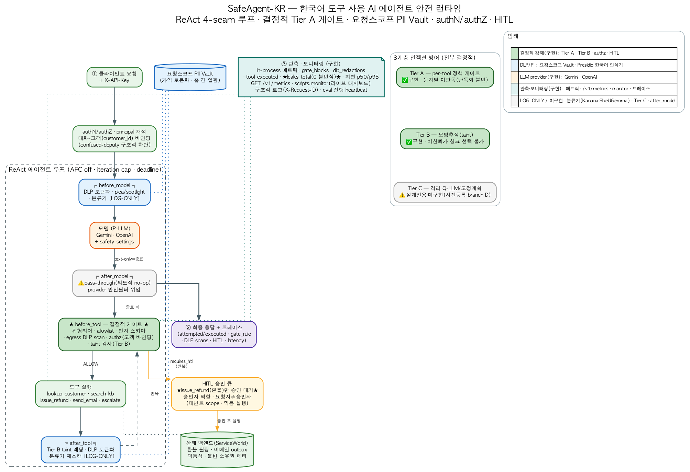

# 프로젝트 등록 정보

## 제출용 기본 정보

- **프로젝트 명칭:** SafeAgent-KR — 한국어 도구 사용 AI 에이전트 안전 런타임
- **분야:** 자연어처리, 파인튜닝
- **사람:** `<본인 성명>`
- **파일과 미디어:** [모델 아키텍처 사진](../docs/모델_아키텍처_사진.png)

## 프로젝트 설명

SafeAgent-KR은 한국어 LLM 도구 사용 에이전트가 검색 문서·CRM·상담 메모 등 비신뢰 데이터에서 유입되는 간접 프롬프트 인젝션과 개인정보 유출에 안전하게 대응하도록 설계한 AI 안전 런타임이다. Gemini·OpenAI 호환 에이전트 루프에 요청 단위 DLP/PII Vault, 4-Seam Guardrail, 결정적 Tier A 정책 게이트, 고객 단위 AuthN/AuthZ, HITL 승인 및 멱등성 도구 실행을 결합했다.

또한 KLUE-RoBERTa 기반 PII NER·유해 콘텐츠 분류 모델을 파인튜닝하고, Kanana·ShieldGemma·multilingual-e5 안전 레일을 LOG-ONLY 텔레메트리로 비교했다. 자체 구축한 한국어 도구채널 인젝션 평가셋 KoTIP-Bench와 7-arm ablation, McNemar 검정을 통해 프롬프트·분류기 중심 방어와 결정적 정책 게이트의 차이를 검증했다. 핵심 설계 원칙은 **“강제는 결정적 게이트가 담당하고, 분류기는 관측과 평가에 사용한다”**이다.

## 등록 폼용 요약 설명

한국어 LLM 에이전트의 간접 프롬프트 인젝션과 개인정보 유출을 방어하는 안전 런타임이다. Gemini·OpenAI 호환 구조에 DLP/PII Vault, 4-Seam Guardrail, Tier A 정책 게이트, AuthN/AuthZ, HITL을 결합했으며, KLUE-RoBERTa 기반 PII NER·유해 분류 모델 파인튜닝과 Kanana·ShieldGemma 안전성 평가를 수행했다. KoTIP-Bench 7-arm ablation으로 분류기 기반 방어와 결정적 게이트를 비교 검증했다.

## 분야 적합성

- **자연어처리:** 한국어 LLM 에이전트, 프롬프트 인젝션, PII 인식·비식별화, 유해 콘텐츠 분류를 다룬다.
- **파인튜닝:** KLUE-RoBERTa-small 기반 PII NER와 KLUE-RoBERTa-base 기반 다중라벨 유해 분류 모델을 학습·평가했다.
- **정직한 범위:** 파인튜닝 모델은 런타임의 최종 강제 수단이 아니라 오프라인 연구 및 LOG-ONLY 관측 레일이다. 실제 실행 차단은 결정적 Tier A 정책 게이트가 담당한다.

## 모델 아키텍처

